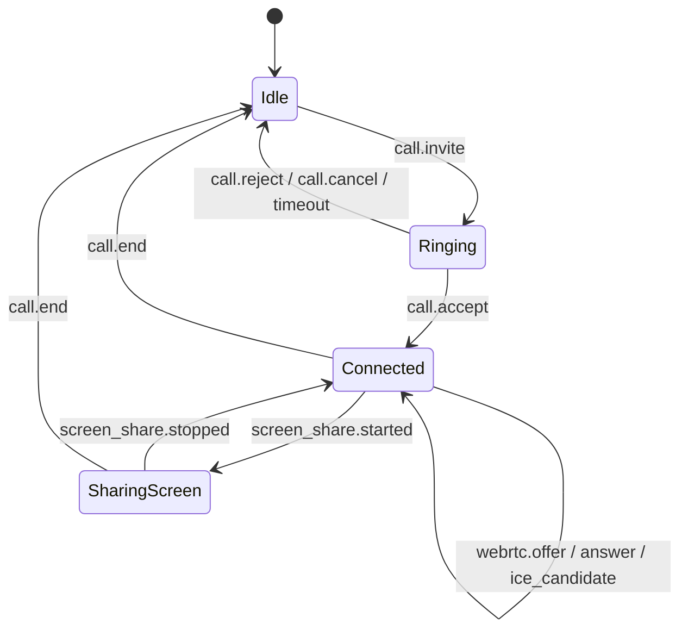

# ConnectX — API & Signaling Protocol Specification

> **Document Status:** Official Interface Specification  
> **Transports:** HTTPS (REST API) & WSS (Signaling WebSocket)  
> **Security:** Bearer Token (Firebase ID Token for Auth Bridge; Supabase Custom JWT for all other endpoints)

---

## 1. REST API Endpoints (`services/api`)

### 1.1 Authentication Bridge

#### `POST /api/v1/auth/exchange-token`
Exchanges a verified Firebase ID token for an authenticated user session and Supabase-compatible JWT.

- **Request Headers:**
  `Content-Type: application/json`
- **Request Body:**
  ```json
  {
    "idToken": "eyJhbGciOiJSUzI1NiIs..."
  }
  ```
- **Response (200 OK):**
  ```json
  {
    "accessToken": "eyJhbGciOiJIUzI1NiIs...",
    "tokenType": "Bearer",
    "expiresIn": 3600,
    "profile": {
      "id": "7f8b3c92-3d5f-4a62-9e28-111122223333",
      "firebaseUid": "v5g7h8j9k0l1",
      "displayName": "Alex Tran",
      "avatarAssetId": null,
      "bio": "Available for call",
      "createdAt": "2026-10-23T12:00:00Z"
    }
  }
  ```
- **Error Responses:**
  - `400 Bad Request`: `{ "error": "MISSING_ID_TOKEN", "message": "idToken is required" }`
  - `401 Unauthorized`: `{ "error": "INVALID_FIREBASE_TOKEN", "message": "Firebase ID token verification failed" }`

---

### 1.2 User & Profile Endpoints

#### `GET /api/v1/profiles/me`
Retrieves current profile and settings.
- **Headers:** `Authorization: Bearer <supabase_custom_jwt>`
- **Response (200 OK):** Profile details and user settings.

#### `PATCH /api/v1/profiles/me`
Updates display name, avatar, bio.
- **Headers:** `Authorization: Bearer <supabase_custom_jwt>`
- **Body:** `{ "displayName": "Alex", "bio": "Hello" }`

---

### 1.3 Media Upload Authorization

#### `POST /api/v1/media/sign-upload`
Generates a cryptographically signed Cloudinary upload ticket without leaking API secrets.

- **Headers:** `Authorization: Bearer <supabase_custom_jwt>`
- **Request Body:**
  ```json
  {
    "conversationId": "a1b2c3d4-e5f6-7890-abcd-ef1234567890",
    "resourceType": "image",
    "mimeType": "image/jpeg",
    "sizeBytes": 2048500
  }
  ```
- **Response (200 OK):**
  ```json
  {
    "cloudName": "connectx-cloud",
    "apiKey": "123456789012345",
    "timestamp": 1740001234,
    "folder": "connectx/conversations/a1b2c3d4-e5f6-7890-abcd-ef1234567890",
    "signature": "c9284fae89127db83921b...",
    "uploadUrl": "https://api.cloudinary.com/v1_1/connectx-cloud/image/upload",
    "maxSizeBytes": 10485760
  }
  ```

---

### 1.4 WebRTC TURN Credentials

#### `GET /api/v1/calls/ice-servers`
Returns short-lived ephemeral TURN/STUN credentials for NAT traversal.
- **Headers:** `Authorization: Bearer <supabase_custom_jwt>`
- **Response (200 OK):**
  ```json
  {
    "iceServers": [
      { "urls": "stun:stun.l.google.com:19302" },
      {
        "urls": "turn:turn.connectx.app:3478",
        "username": "1740003600:7f8b3c92",
        "credential": "generated-hmac-sha1-credential"
      }
    ]
  }
  ```

---

## 2. Signaling WebSocket Protocol (`services/signaling`)

- **URL:** `wss://<signaling_host>/ws?token=<supabase_custom_jwt>`
- **Heartbeat:** Ping/Pong every 30 seconds. Inactive sockets terminated after 60 seconds.

### 2.1 Event Framing
All messages are JSON objects adhering to:
```typescript
interface SignalingMessage<T = unknown> {
  type: SignalingEventType;
  callId: string;
  senderId: string;
  targetId?: string; // Target participant or null for room broadcast
  payload: T;
  timestamp: string; // ISO-8601
}
```

### 2.2 Event Types & State Diagram



| Event Type | Direction | Description |
| :--- | :--- | :--- |
| `call.invite` | Client -> Server -> Target | Initiates a call with audio/video mode |
| `call.ringing` | Target -> Server -> Caller | Acknowledges receipt of call invite |
| `call.accept` | Target -> Server -> Caller | Accepts call; both peers prepare WebRTC |
| `call.reject` | Target -> Server -> Caller | Callee declines (`busy`, `declined`) |
| `call.cancel` | Caller -> Server -> Target | Caller hangs up before answer |
| `call.end` | Peer -> Server -> Remote | Call ends; teardown PeerConnection & tracks |
| `webrtc.offer` | Peer -> Server -> Remote | SDP Offer exchange |
| `webrtc.answer` | Peer -> Server -> Remote | SDP Answer exchange |
| `webrtc.ice_candidate` | Peer -> Server -> Remote | Trickle ICE candidates |
| `screen_share.started` | Peer -> Server -> Remote | Notifies peer that screen track is active |
| `screen_share.stopped` | Peer -> Server -> Remote | Notifies peer that screen track has ended |
| `participant.mute_changed` | Peer -> Server -> Remote | Audio/Video mute state sync |
