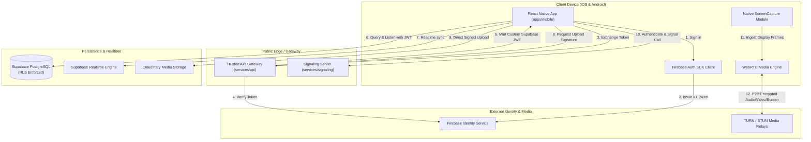

# ConnectX — System Architecture Document

> **Document Status:** Official Architecture Specification for ConnectX  
> **Repository Pattern:** Modular Monorepo (pnpm / npm workspaces)  
> **Last Updated:** 2026-10-23

---

## 1. High-Level Architecture Topology

ConnectX is structured as a decoupled, zero-trust mobile communication platform.



---

## 2. Directory & Package Structure

```text
connectx/
├── apps/
│   └── mobile/                      # Bare React Native Mobile App
│       ├── src/
│       │   ├── app/                 # Root App bootstrap, themes, providers
│       │   ├── components/          # Design system & reusable primitives
│       │   ├── features/            # Domain-driven features
│       │   │   ├── auth/            # Firebase login/register, token exchange
│       │   │   ├── profile/         # User profile, status, avatar
│       │   │   ├── contacts/        # Search, add, block contacts
│       │   │   ├── conversations/   # Conversation lists, member management
│       │   │   ├── messaging/       # Chat screen, messages, reactions
│       │   │   ├── media/           # Cloudinary upload progress & preview
│       │   │   ├── calls/           # WebRTC 1:1 audio/video call UI
│       │   │   ├── screen-sharing/  # Screen sharing UI, system prompt triggers
│       │   │   ├── notifications/   # Push notification listeners
│       │   │   └── settings/        # Privacy, read receipts, security
│       │   ├── navigation/          # React Navigation stacks & tabs
│       │   ├── services/            # Client singletons (API, Supabase, WebRTC)
│       │   ├── state/               # Zustand store slices
│       │   ├── hooks/               # Custom React hooks
│       │   ├── types/               # Local app types
│       │   └── utils/               # Formatting, error handling, redaction
│       ├── android/                 # Native Android app, MediaProjection service
│       └── ios/                     # Native iOS app, ReplayKit Broadcast Extension
├── services/
│   ├── api/                         # Fastify/Express Trusted Backend
│   │   ├── src/
│   │   │   ├── routes/              # Auth bridge, media sign, user endpoints
│   │   │   ├── services/            # Firebase Admin, Supabase Admin, Cloudinary
│   │   │   └── middleware/          # JWT auth verification, error handler
│   │   ├── package.json
│   │   └── tsconfig.json
│   ├── signaling/                   # WebRTC WebSocket Signaling Server
│   │   ├── src/
│   │   │   ├── signaling-server.ts  # WS server, room management, event dispatcher
│   │   │   └── event-handlers.ts    # Call invite, offer, answer, ice, screen
│   │   ├── package.json
│   │   └── tsconfig.json
│   └── workers/                     # Background jobs & FCM push dispatchers
├── supabase/
│   ├── migrations/                  # Versioned SQL migrations (001_initial_schema.sql, etc.)
│   ├── seed.sql                     # Development test seed data
│   └── config.toml                  # Supabase local CLI config
├── packages/
│   └── shared-types/                # Shared TypeScript models across client & server
│       ├── src/
│       │   ├── auth.ts              # Auth DTOs & token exchange interfaces
│       │   ├── database.ts          # Supabase Database schema definitions
│       │   ├── messaging.ts         # Message, conversation, and attachment models
│       │   ├── signaling.ts         # WebRTC signaling event protocol definitions
│       │   └── index.ts
│       ├── package.json
│       └── tsconfig.json
├── docs/                            # Formal specifications & documentation
│   ├── TECH_DECISIONS.md
│   ├── ARCHITECTURE.md
│   ├── DATABASE.md
│   ├── SECURITY.md
│   ├── SCREEN_SHARING.md
│   ├── API.md
│   └── TEST_PLAN.md
├── .env.example
├── README.md
└── AGENTS.md
```

---

## 3. Communication Patterns & Lifecycle

### 3.1 Realtime Messaging
- Transport: Supabase Realtime channel subscribed to `messages:conversation_id=eq.{id}`.
- Persistence: Postgres DB with RLS enforcing conversation membership.
- Offline & Resilience: Messages sent with an idempotency key `client_message_id`. If connection drops, optimistic message stays queued and retries upon reconnect without creating duplicates.

### 3.2 Realtime WebRTC Media & Screen Sharing
- Audio & Camera: Bidirectional peer connection over SRTP/DTLS.
- Screen Video Track: Unidirectional high-definition (15 fps, adaptive 720p/1080p) media stream injected into the existing PeerConnection via `RTCRtpSender.replaceTrack()` or adding a dedicated screen track.
- Teardown: Call termination from either participant cleanly closes the RTCPeerConnection and notifies the OS Foreground Service / Broadcast Extension to release resources.
