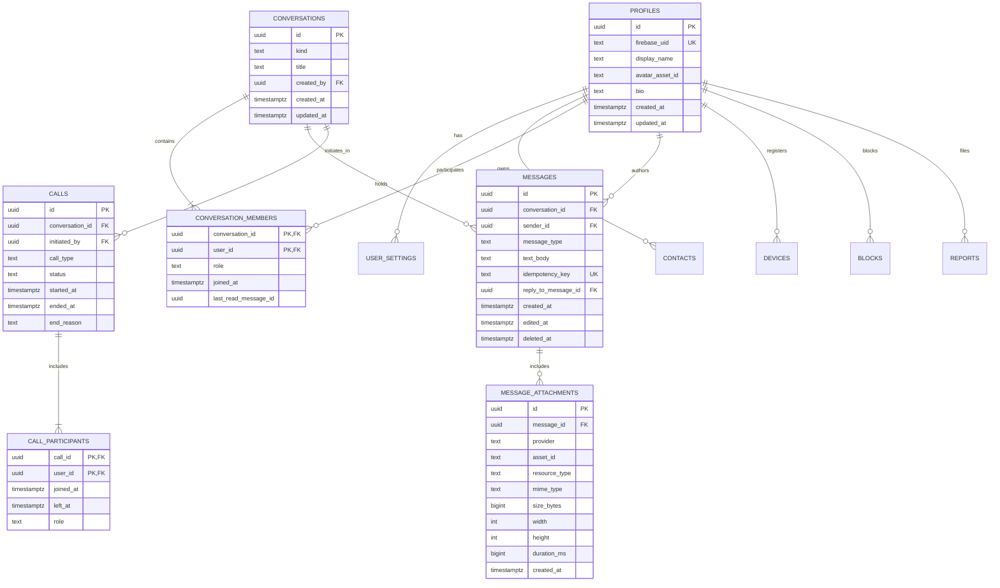

# ConnectX — Database Schema & RLS Policies

> **Document Status:** Official Schema Specification  
> **Database Engine:** PostgreSQL 15+ (Supabase)  
> **Security Strategy:** Row Level Security (RLS) on all user-accessible tables

---

## 1. Schema Diagram (ERD)

---

## 2. Table Specifications & Constraints

### 2.1 `profiles`
- Primary Key: `id uuid DEFAULT gen_random_uuid()`
- `firebase_uid text UNIQUE NOT NULL`
- `display_name text NOT NULL CHECK (char_length(display_name) >= 1 AND char_length(display_name) <= 64)`
- `avatar_asset_id text NULL`
- `bio text NULL CHECK (char_length(bio) <= 256)`
- `created_at timestamptz NOT NULL DEFAULT now()`
- `updated_at timestamptz NOT NULL DEFAULT now()`

### 2.2 `user_settings`
- Primary Key: `user_id uuid REFERENCES profiles(id) ON DELETE CASCADE`
- `allow_messages_from text NOT NULL DEFAULT 'everyone' CHECK (allow_messages_from IN ('everyone', 'contacts_only'))`
- `show_presence boolean NOT NULL DEFAULT true`
- `read_receipts_enabled boolean NOT NULL DEFAULT true`
- `notification_preferences jsonb NOT NULL DEFAULT '{"messages": true, "calls": true, "preview_text": false}'::jsonb`
- `updated_at timestamptz NOT NULL DEFAULT now()`

### 2.3 `contacts`
- Primary Key: `(owner_id, contact_id)`
- `owner_id uuid NOT NULL REFERENCES profiles(id) ON DELETE CASCADE`
- `contact_id uuid NOT NULL REFERENCES profiles(id) ON DELETE CASCADE`
- `status text NOT NULL DEFAULT 'accepted' CHECK (status IN ('pending', 'accepted', 'blocked'))`
- `created_at timestamptz NOT NULL DEFAULT now()`
- Constraint: `CHECK (owner_id <> contact_id)`

### 2.4 `conversations`
- Primary Key: `id uuid DEFAULT gen_random_uuid()`
- `kind text NOT NULL CHECK (kind IN ('direct', 'group'))`
- `title text NULL CHECK (kind = 'direct' OR char_length(title) >= 1)`
- `created_by uuid REFERENCES profiles(id) ON DELETE SET NULL`
- `created_at timestamptz NOT NULL DEFAULT now()`
- `updated_at timestamptz NOT NULL DEFAULT now()`

### 2.5 `conversation_members`
- Primary Key: `(conversation_id, user_id)`
- `conversation_id uuid NOT NULL REFERENCES conversations(id) ON DELETE CASCADE`
- `user_id uuid NOT NULL REFERENCES profiles(id) ON DELETE CASCADE`
- `role text NOT NULL DEFAULT 'member' CHECK (role IN ('owner', 'admin', 'member'))`
- `joined_at timestamptz NOT NULL DEFAULT now()`
- `last_read_message_id uuid NULL`

### 2.6 `messages`
- Primary Key: `id uuid DEFAULT gen_random_uuid()`
- `conversation_id uuid NOT NULL REFERENCES conversations(id) ON DELETE CASCADE`
- `sender_id uuid NOT NULL REFERENCES profiles(id) ON DELETE CASCADE`
- `message_type text NOT NULL CHECK (message_type IN ('text', 'image', 'video', 'file', 'system'))`
- `text_body text NULL`
- `idempotency_key text NULL UNIQUE`
- `reply_to_message_id uuid NULL REFERENCES messages(id) ON DELETE SET NULL`
- `created_at timestamptz NOT NULL DEFAULT now()`
- `edited_at timestamptz NULL`
- `deleted_at timestamptz NULL`

### 2.7 `message_attachments`
- Primary Key: `id uuid DEFAULT gen_random_uuid()`
- `message_id uuid NOT NULL REFERENCES messages(id) ON DELETE CASCADE`
- `provider text NOT NULL DEFAULT 'cloudinary'`
- `asset_id text NOT NULL`
- `resource_type text NOT NULL CHECK (resource_type IN ('image', 'video', 'raw'))`
- `mime_type text NULL`
- `size_bytes bigint NULL`
- `width int NULL`
- `height int NULL`
- `duration_ms bigint NULL`
- `created_at timestamptz NOT NULL DEFAULT now()`

### 2.8 `calls` & `call_participants`
- `calls`: Records metadata for billing, history, and status tracking (`initiated`, `ringing`, `active`, `ended`, `missed`, `rejected`).
- Media tracks (audio, camera, and screen sharing) are real-time WebRTC streams and **never** stored in the database.

---

## 3. RLS Security Model Matrix

| Table | SELECT | INSERT | UPDATE | DELETE |
| :--- | :--- | :--- | :--- | :--- |
| `profiles` | `authenticated` users | Backend Auth Bridge only | `auth.uid() = id` | Disabled (Admin only) |
| `user_settings` | `auth.uid() = user_id` | Auto-created on signup | `auth.uid() = user_id` | Cascade on profile delete |
| `contacts` | `auth.uid() = owner_id` | `auth.uid() = owner_id` | `auth.uid() = owner_id` | `auth.uid() = owner_id` |
| `conversations` | Active member of conversation | Authenticated users | Owner or Admin member | Owner only |
| `conversation_members` | Active member of conversation | Self (join group) or Group Admin | `auth.uid() = user_id` (last read) | Self (leave) or Admin |
| `messages` | Active member of conversation | Member of conversation AND `sender_id = auth.uid()` | `sender_id = auth.uid()` (within window) | Soft-delete only (`sender_id = auth.uid()`) |
| `message_attachments`| Member of message's conversation | Author of parent message | Prohibited | Cascade on message delete |
| `calls` | Participant or member of conversation | Caller (`initiated_by = auth.uid()`) | Participant in call | Prohibited |
