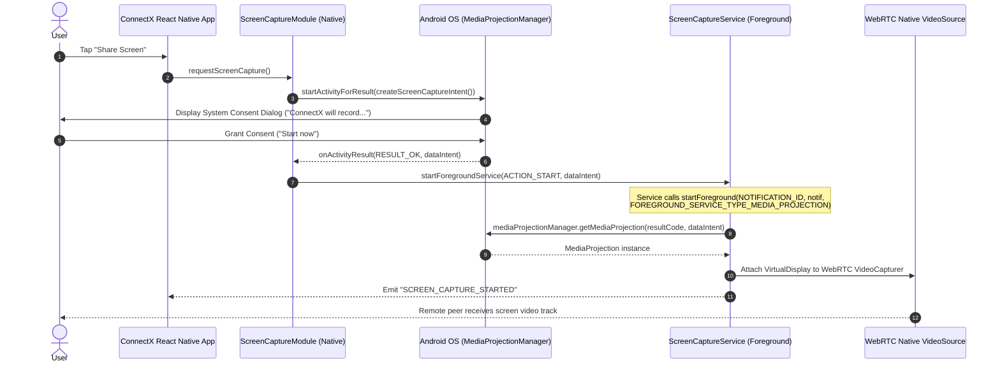
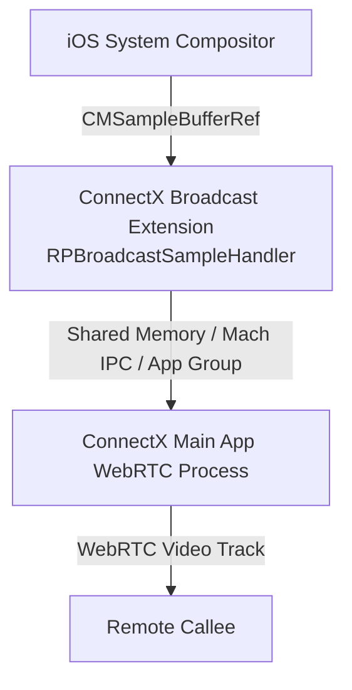

# ConnectX — Native Screen Sharing Specification & Verification

> **Document Status:** Official Technical Specification for Screen Sharing  
> **Target OS:** Android 10+ (API 29–35), iOS 14.0+  
> **Component Level:** Native OS Integration, WebRTC Video Track Injection, Lifecycle & Security

---

## 1. Overview & Core Principles

Screen sharing in ConnectX is a **first-class, core capability** that allows an active call participant to stream their device display to remote participants with full operating system consent.

### Hard Security & Regulatory Constraints
1. **Explicit User Initiation Only:** The application must never attempt programmatic or silent screen capture. Every capture session must be initiated by an unambiguous user gesture (tap "Share Screen").
2. **Mandatory OS Consent:**
   - On Android: The system dialog created by `MediaProjectionManager.createScreenCaptureIntent()` must be presented to the user.
   - On iOS: The system broadcast picker `RPSystemBroadcastPickerView` must be presented to the user.
3. **No Bypass of Security Surfaces (`FLAG_SECURE` / DRM):**
   - Content protected by Android `WindowManager.LayoutParams.FLAG_SECURE` (e.g., banking apps, password fields, authenticator apps) or Widevine/FairPlay DRM will appear as **solid black frames** or be omitted by the hardware compositor.
   - ConnectX acknowledges and strictly respects this OS boundary. No attempt to hook or bypass `FLAG_SECURE` is made.
4. **Persistent Indicator & Immediate Stop Control:**
   - Both in-app UI (floating toolbar/tile) and OS-level controls (system notification on Android, red status bar on iOS) provide an instant one-tap stop action.
5. **Automatic Teardown:**
   - When the remote peer hangs up, the local user ends the call, or the OS revokes permission, the media projection, virtual display, and extension must immediately terminate and release hardware encoders.

---

## 2. Android Native Architecture (`MediaProjection`)

### 2.1 Android 14+ (API 34) & Android 15 (API 35) Lifecycle Rules
Under modern Android versions, attempting to obtain a `MediaProjection` without an active foreground service of type `mediaProjection` will immediately trigger a fatal `SecurityException`.

The strict execution sequence is:


### 2.2 Foreground Service & Manifest Declarations
Required manifest permissions in `android/app/src/main/AndroidManifest.xml`:
```xml
<!-- Required permissions for screen capture & foreground service -->
<uses-permission android:name="android.permission.FOREGROUND_SERVICE" />
<uses-permission android:name="android.permission.FOREGROUND_SERVICE_MEDIA_PROJECTION" />
<uses-permission android:name="android.permission.POST_NOTIFICATIONS" />

<application ...>
    <service
        android:name="com.connectx.screencapture.ScreenCaptureService"
        android:enabled="true"
        android:exported="false"
        android:foregroundServiceType="mediaProjection" />
</application>
```

### 2.3 Handling `MediaProjection.Callback`
The native service must register a callback:
```java
mediaProjection.registerCallback(new MediaProjection.Callback() {
    @Override
    public void onStop() {
        // Triggered if the user taps "Stop sharing" from system quick settings
        // or another app takes projection
        stopCaptureAndCleanup();
        notifyReactNativeSessionStopped();
    }
}, handler);
```

---

## 3. iOS Native Architecture (ReplayKit Broadcast Extension)

### 3.1 Broadcast Upload Extension
To capture screens outside of the ConnectX app (full device capture), iOS requires an **App Extension** of type `com.apple.broadcast-services-upload`.



### 3.2 Key iOS Technical Constraints
1. **Memory Ceiling (Jetsam):** iOS kills broadcast upload extensions if memory footprint exceeds ~50 MB.
   - All sample buffer processing must be zero-copy where possible.
   - Do not allocate large intermediate buffers.
2. **App Group Shared Memory:** Both the main app target and extension target must belong to the same App Group (e.g. `group.com.connectx.app`).
3. **Darwin Notification Center:** Used to signal start/stop events between the extension and the main app process.
4. **UI Trigger:** `RPSystemBroadcastPickerView` must be embedded in the UI to launch the system picker sheet.

---

## 4. Protected Content & Limitation Matrix

| Scenario / Source App | Expected Android Behavior | Expected iOS Behavior | App Handling |
| :--- | :--- | :--- | :--- |
| **Normal Apps (Social, Web, Maps)** | Full resolution video stream captured | Full resolution video stream captured | Normal streaming |
| **Banking / FinTech Apps** | Rendered as solid **BLACK** screen (`FLAG_SECURE`) | Rendered as blank/black frame | Display toast / hint to user |
| **DRM Video (Netflix, Apple TV+)** | Black video frame / protected surface hidden | Protected surface obscured | Normal expected DRM compliance |
| **Password Inputs (Secure EditText)** | Hidden or black box depending on OEM keyboard | Obscured by iOS system | Expected security compliance |
| **Incoming Phone Call** | Audio focus interrupted; screen continues or suspends | iOS pauses extension during cellular call | WebRTC track muted / paused |
| **App Backgrounded during share** | Full device capture continues uninterrupted | Full device capture continues uninterrupted | Foreground service / status bar remains active |
| **User locks screen** | Screen display off; encoder emits black/static frame | Broadcast paused by ReplayKit | Pause video transmission to save battery |

---

## 5. WebRTC Track Integration Contract

1. **Resolution & Framerate Adaptations:**
   - Default Capture: 1080x1920 (scaled down dynamically to 720x1280 or 540x960 based on network estimator / RTCP feedback).
   - Frame Rate: 15 fps (ideal for text readability and battery efficiency; text does not require 30/60 fps).
   - Bitrate: Max 1.5 Mbps with VP8/H.264 constrained baseline.
2. **Signaling State:**
   - Emits `screen_share.started` with `{ participantId, callId, streamId }` over signaling WebSocket.
   - Emits `screen_share.stopped` when capture ends.
3. **Remote Layout:**
   - Callee UI switches to dominant screen-share view with Picture-in-Picture (PiP) for the caller's camera feed.
